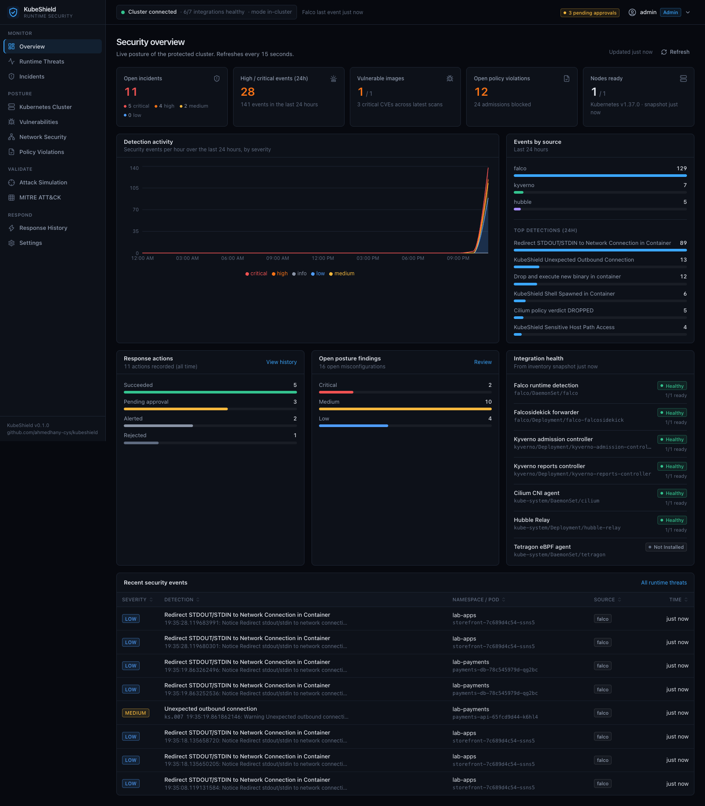
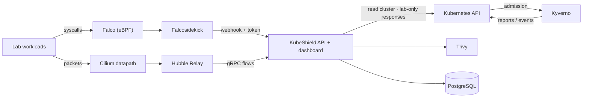
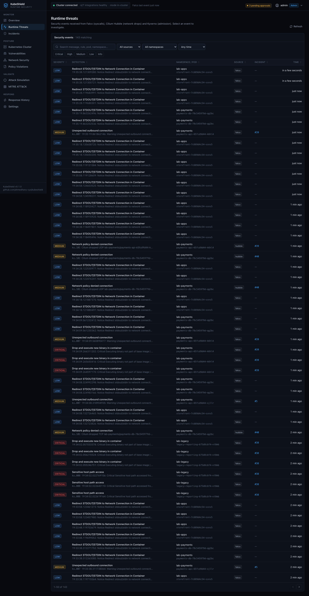
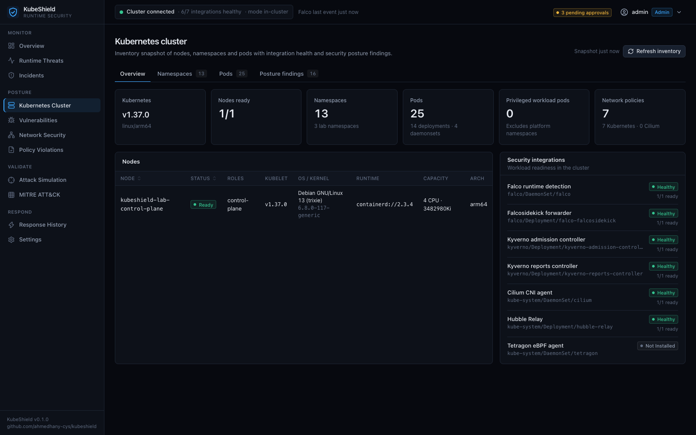
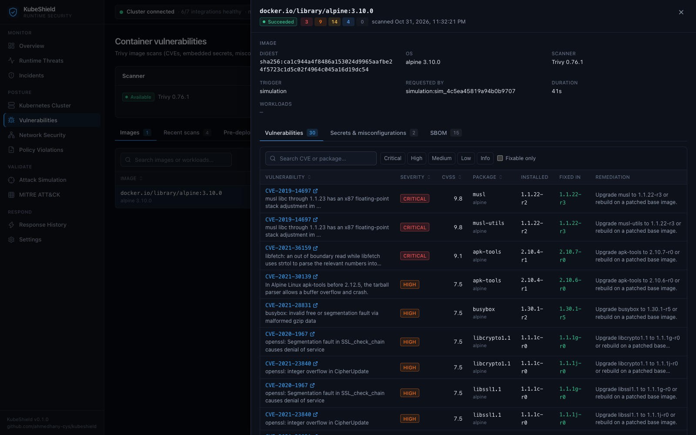
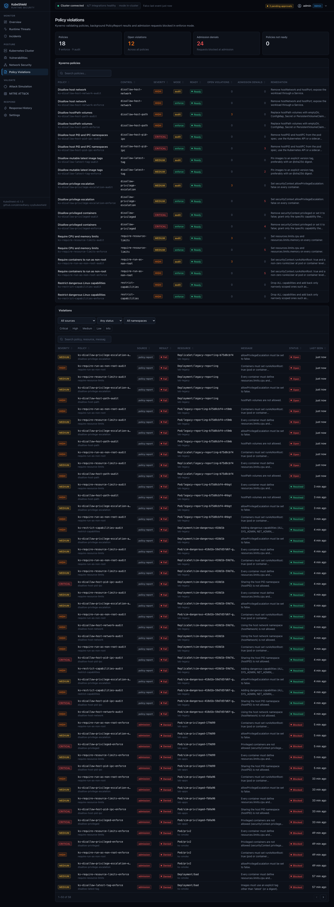
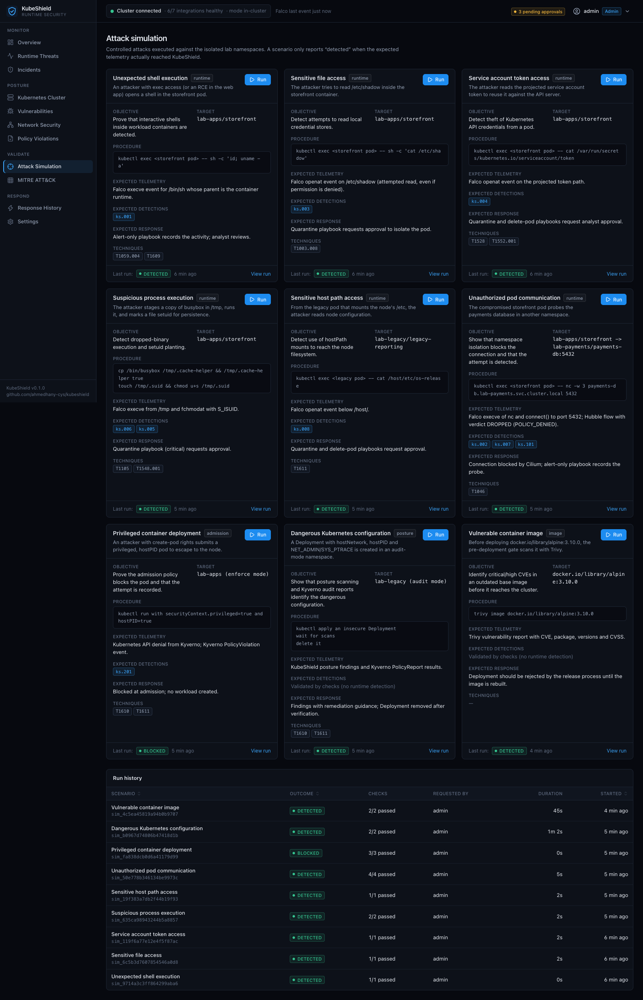
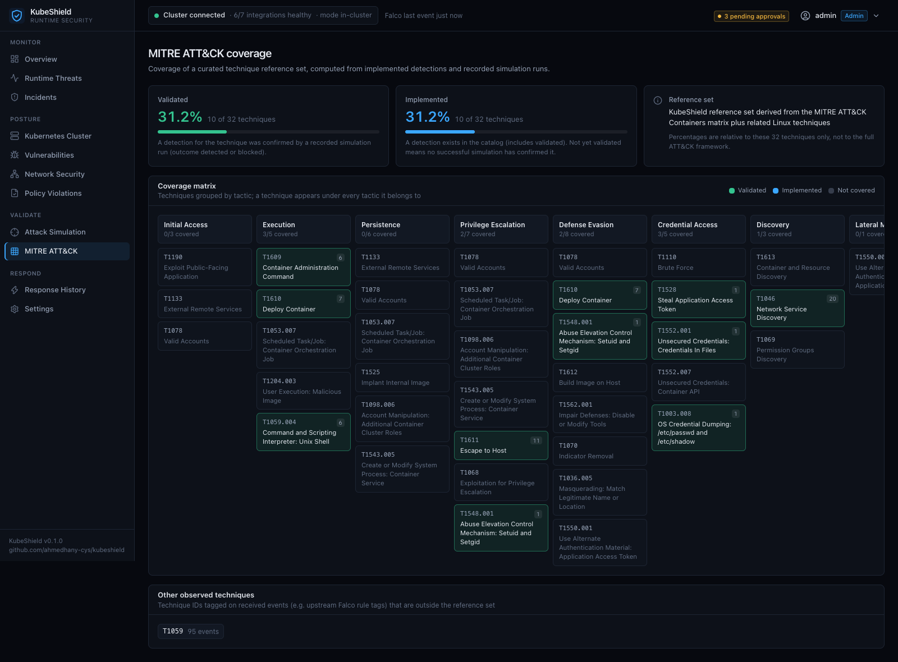
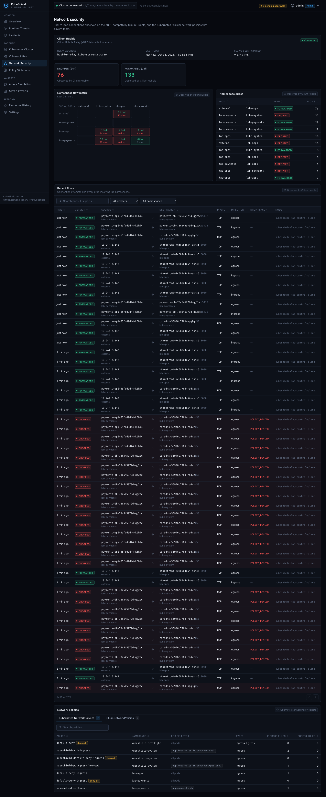
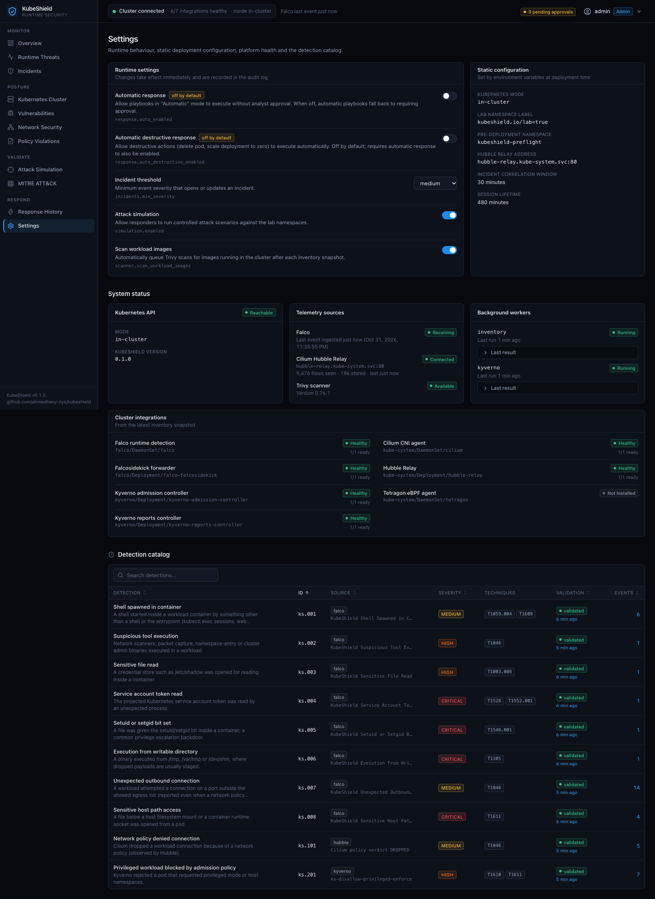

# KubeShield

**Kubernetes runtime threat detection and automated response platform.**

KubeShield detects malicious container activity, finds dangerous cluster configuration, correlates
everything into incidents and runs approval-gated responses whose outcomes are verified against the live
cluster, not assumed. It integrates established open-source security tools (Falco, Cilium/Hubble,
Kyverno, Trivy) and adds what they lack on their own: correlation, response with datapath verification,
attack simulation, and ATT&CK coverage computed from evidence.

```
DETECT  ->  INVESTIGATE  ->  RESPOND  ->  VERIFY
Falco · Hubble · Kyverno     incidents     approval-gated     read-back checks +
Trivy · posture checks       + evidence    Cilium quarantine   real connectivity tests
```

> Laboratory project. It runs on a local, loopback-only kind cluster and makes no production-readiness
> claims. See [limitations](docs/limitations.md).



## What it does

| Area | Capability | Source of truth |
|---|---|---|
| Runtime threats | 8 custom Falco rules + upstream ruleset, normalised events with process, evidence, ATT&CK and recommended response | Falco modern eBPF probe |
| Network | L3/L4 flow observations for lab namespaces; policy-denied connections raised as detections | Cilium Hubble Relay (gRPC) |
| Admission policy | 9 guardrails as Kyverno `ValidatingPolicy` in enforce and audit modes; violations and blocked admissions | Kyverno PolicyReports and Events |
| Posture | Privileged/host-namespace pods, dangerous capabilities, hostPath, root, limits, mutable tags, risky RBAC bindings, namespaces without default-deny | Kubernetes API |
| Images | CVEs (package, installed/fixed version, severity, CVSS), secrets, image misconfigurations, CycloneDX SBOM summary | Trivy |
| Pre-deployment gate | Manifest → server-side dry-run through Kyverno + Trivy config scan + image scan → pass/warn/fail | Kubernetes API, Trivy |
| Incidents | Correlation per pod in a 30-minute window, attack-chain severity escalation, status workflow, audit trail | PostgreSQL |
| Response | Alert, isolate pod (Cilium deny policy), release, delete pod with forensics, scale to zero, namespace containment | Kubernetes API + Cilium |
| Validation | 9 attack scenarios executed in the lab and verified from received telemetry | KubeShield database |
| ATT&CK | Coverage over a 32-technique reference set; a technique counts as validated only after a successful run | Simulation runs |

## Architecture



Details, data flow and design decisions: [docs/architecture.md](docs/architecture.md).

| Component | Version tested |
|---|---|
| Kubernetes (kind node) | 1.37.0, containerd 2.3.4, kernel 6.8 (Colima VM), arm64 |
| kind | 0.33.0 |
| Cilium + Hubble Relay | 1.20.4 |
| Falco / chart | 0.45.2 / 9.2.2 (modern_ebpf driver) |
| Kyverno / chart | 1.19.2 / 3.9.2 |
| Trivy | 0.76.1 |
| PostgreSQL | 17.6 |
| Backend | Python 3.13, FastAPI, SQLAlchemy 2, Pydantic 2 |
| Frontend | React 19, TypeScript, Tailwind CSS 4, Recharts 3, Vite 8 |

## Validation results

`e2e/run_e2e.py` runs every scenario through the API, then approves a playbook's isolation request and
proves containment with real connections. The generated report:
[docs/validation/detection-validation-report.md](docs/validation/detection-validation-report.md).

Last full automated run (2026-10-31, before the final noise-tuning and containment fixes below):

| Scenario | Expected | Outcome |
|---|---|---|
| Unexpected shell execution | ks.001 | detected |
| Sensitive file access | ks.003 | detected |
| Service account token access | ks.004 | detected |
| Suspicious process execution (dropped binary + setuid) | ks.006, ks.005 | detected |
| Sensitive host path access | ks.008 | detected |
| Unauthorized pod communication | ks.002, ks.007, ks.101 + connection blocked | detected |
| Privileged container deployment | Kyverno denial + ks.201 | blocked |
| Dangerous Kubernetes configuration | posture findings + Kyverno audit reports | detected |
| Vulnerable image (`alpine:3.10.0`) | critical/high CVEs before deployment | detected (3 critical, 9 high) |
| Response flow | approve → isolate → verify → traffic blocked both ways → audit → release → restored | 10/10 checks passed |

Additional live checks performed against the cluster (via the API, results recorded in its audit log):
delete pod with forensics capture — succeeded; scale to zero — succeeded; namespace containment — see the
next section.

### Problems found by testing (and fixed)

Testing against real telemetry and real traffic changed the design in several places:

- **Policy object ≠ enforcement.** The first quarantine created its Cilium policy and was "verified", yet
  traffic still flowed: Cilium enforces only after the pod gets a new security identity (~20–25 s here).
  Isolation is now verified by polling the pod's `CiliumEndpoint` identity.
- **Deny-only Cilium policies default-deny the endpoint.** Namespace containment initially broke DNS;
  it now sets `enableDefaultDeny: false`.
- **The kind API server is a host identity.** Namespace-selector denies did not block it; containment now
  denies the `kube-apiserver`, `host` and `remote-node` entities. Verified manually with real connections
  (DNS and same-namespace traffic kept; API server and cross-namespace pod blocked). The automated
  containment check was added to `run_e2e.py` but has **not completed a full run yet** (see below).
- **Falco details:** enter events are gone in 0.45, failed `connect()` calls have no socket tuple, `fchmodat`
  reports `SUCCESS` not `0`, and the default `rule_matching: first` hid KubeShield alerts behind upstream
  rules. See [detection-rules.md](docs/detection-rules.md).
- **API contract bug:** unexecuted actions returned `verification: {}` and crashed two dashboard pages;
  the API now returns `null`.

## Screenshots

All screenshots come from the running application with data produced by the scenarios above
(`e2e/screenshots.py`, Playwright).

| | |
|---|---|
|  Runtime threat detection |  Kubernetes cluster and posture |
|  Image vulnerability scanning |  Kyverno policies and violations |
|  Attack simulation results |  ATT&CK coverage from validation runs |
|  Hubble flows and policies |  Settings, integrations, detection catalog |

The incident-investigation and response-history screenshots are not included yet: they were captured
before the API fix above and showed the crash. They will be regenerated with the next full run.

## Quick start

Requirements: Docker-compatible runtime, kind, kubectl, Helm, openssl. About 4 CPUs, 3.5 GB RAM for
the VM and **at least 15 GB of free disk**. Full guide: [docs/installation.md](docs/installation.md).

```bash
git clone https://github.com/ahmedhany-cys/kubeshield.git
cd kubeshield
./scripts/lab-up.sh
```

Open <http://127.0.0.1:8080>, user `admin`. The generated password:

```bash
kubectl --context kind-kubeshield-lab -n kubeshield-system get secret kubeshield-secrets -o jsonpath='{.data.admin-password}' | base64 -d; echo
```

Validate everything and regenerate the report and screenshots:

```bash
python3 -m venv e2e/.venv && e2e/.venv/bin/pip install -r e2e/requirements.txt
e2e/.venv/bin/python e2e/run_e2e.py
e2e/.venv/bin/python e2e/screenshots.py --browser-channel chrome
```

## Testing

| Layer | What | How |
|---|---|---|
| Unit (61 tests) | Falco normalisation, incident correlation, playbooks and safety switches, response execution and verification (fake Kubernetes), lab guard, posture and RBAC checks, Trivy parsing and input validation, auth/CSRF/rate limiting/JWT tampering, Hubble flow conversion, Kyverno parsing, ATT&CK coverage | `cd backend && python -m pytest` |
| End-to-end | All scenarios, approval-gated isolation with traffic tests, namespace containment, audit trail | `e2e/run_e2e.py` |
| Static / supply chain | ruff, strict TypeScript, Helm lint, Falco rule validation, Trivy config/secret/image scans, pip-audit, npm audit | `.github/workflows/` |

## Security

KubeShield runs without cluster-admin: a read-only ClusterRole (no Secrets, no ConfigMaps) plus write
Roles only in lab namespaces. Responses re-check the `kubeshield.io/lab=true` label before every action,
automatic and destructive responses are off by default, and every decision is audited. Its own pods pass
its own enforce-mode policies. Full model and every permission: [docs/security-model.md](docs/security-model.md).
Reporting vulnerabilities: [SECURITY.md](SECURITY.md).

## Documentation

[Architecture](docs/architecture.md) · [Installation](docs/installation.md) ·
[Configuration](docs/configuration.md) · [Detection rules](docs/detection-rules.md) ·
[Incident response](docs/incident-response.md) · [Attack simulation](docs/attack-simulation.md) ·
[MITRE mapping](docs/mitre-mapping.md) · [Security model](docs/security-model.md) ·
[Troubleshooting](docs/troubleshooting.md) · [Limitations](docs/limitations.md)

## Repository layout

```
backend/        FastAPI service (kubeshield package), unit tests, Hubble protos
frontend/       React + TypeScript dashboard
deploy/         kind config, Cilium/Falco/Kyverno values, Falco rules, Helm charts, lab manifests
e2e/            end-to-end validation harness and screenshot capture
scripts/        lab-up.sh / lab-down.sh
docs/           documentation, validation report, screenshots
```

## License

[Apache License 2.0](LICENSE). Third-party components keep their own licenses; the Hubble API protos in
`backend/proto` are from the Cilium project (Apache-2.0).
