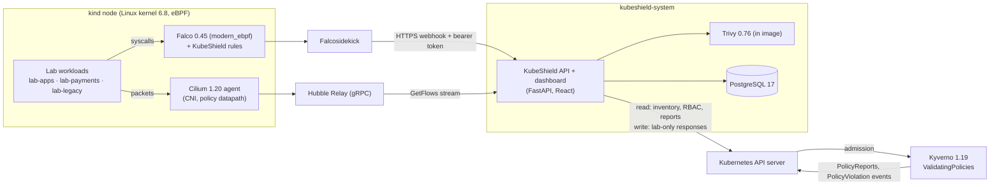
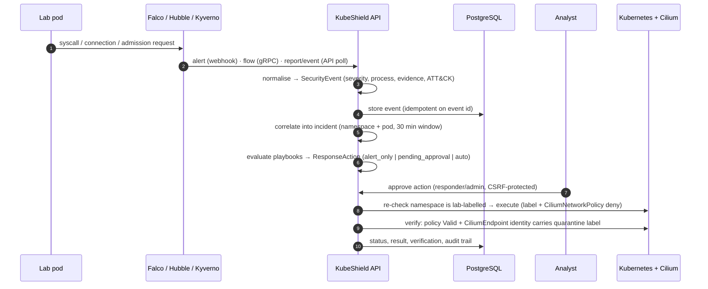

# Architecture

KubeShield is a single API service (FastAPI + PostgreSQL) that turns telemetry from established
open-source security tools into correlated incidents, verified responses and validated detections.
It does not re-implement kernel instrumentation or admission control; it integrates the projects
that already do this well and adds the parts they lack: correlation, an approval-gated response
engine with datapath verification, posture analysis, attack simulation and evidence-backed
ATT&CK coverage.

## Components

| Component | Role in KubeShield | Why it was chosen |
|---|---|---|
| **Falco** (modern eBPF probe) | Runtime syscall detection. Ships 8 KubeShield rules (`deploy/falco/kubeshield_rules.yaml`) plus the upstream stable ruleset. | CNCF-graduated, kernel-level visibility without a kernel module, rich container metadata. |
| **Falcosidekick** | Forwards Falco alerts to `POST /api/v1/ingest/falco` with a bearer token. | Supports custom auth headers (Falco's own `http_output` does not). |
| **Cilium + Hubble Relay** | CNI and network policy datapath; Hubble streams L3/L4 flow verdicts. KubeShield uses Cilium *deny* policies for quarantine. | Deny rules override allow rules (Kubernetes NetworkPolicies cannot do this); Hubble provides real flow observations. |
| **Kyverno** | Admission control with `ValidatingPolicy` (CEL) in enforce and audit modes; background scans produce PolicyReports. | Kubernetes-native, CEL policies, PolicyReport API. |
| **Trivy** | Image vulnerability, secret and image-config scanning; CycloneDX SBOM; manifest misconfiguration scanning for the pre-deployment gate. | Single static binary, offline-capable DB, broad ecosystem coverage. |
| **PostgreSQL** | Events, incidents, responses, audit trail, findings, scans, flows, simulation runs. | Durable, transactional audit trail. |
| **Tetragon** | *Not deployed* — see [limitations](limitations.md). The integrations panel reports it as `not_installed`. | |

## Data flow

### Ingestion paths

| Source | Transport | Normalised into |
|---|---|---|
| Falco | Falcosidekick webhook, bearer token, 1 MB limit | `SecurityEvent` (source `falco`), rule id `ks.00x` for KubeShield rules |
| Cilium | Hubble Relay `observer.Observer/GetFlows` (follow) | `NetworkFlow` rows for lab namespaces; `SecurityEvent` `ks.101` for `POLICY_DENIED` drops |
| Kyverno | PolicyReports + `PolicyViolation` Events (`reportingComponent=kyverno-admission`) | `PolicyViolation` rows; `SecurityEvent` `ks.201` for blocked privileged/host workloads |
| Kubernetes API | Periodic inventory (60 s) | `InventorySnapshot`, `PostureFinding` (pods, controllers, RBAC, network isolation) |
| Trivy | Subprocess (argv list, no shell) | `ImageScan`, `Vulnerability`, `ImageFinding`, SBOM summary |

### Backend modules (`backend/kubeshield/`)

| Module | Responsibility |
|---|---|
| `ingest.py` | Falco payload normalisation and idempotent storage |
| `incidents.py` | Correlation, severity escalation (≥3 distinct detections → at least *high*), status workflow |
| `response/engine.py` | Playbooks, approval workflow, safe execution, audit |
| `response/actions.py` | Isolate / release / delete (with forensics) / scale-to-zero / namespace containment + verification |
| `k8s/inventory.py`, `k8s/posture.py` | Cluster discovery, integration health, posture checks |
| `policy/kyverno.py` | Policy status, report and admission-denial sync |
| `network/hubble.py` | gRPC flow stream (stubs generated from Cilium v1.20.4 protos) |
| `scanners/trivy.py` | Image and manifest scanning, SBOM |
| `simulation/scenarios.py` | Attack scenarios and telemetry-based verification |
| `mitre.py`, `catalog.py` | Detection catalog and ATT&CK coverage derived from validation runs |
| `workers.py` | Background loops (inventory, Kyverno, Hubble) |

## Deployment topology

- Namespace `kubeshield-system` (Kyverno enforce mode — KubeShield's own pods must pass its policies):
  `kubeshield-api` Deployment, `kubeshield-postgres` StatefulSet, ClusterIP service for ingestion,
  NodePort `30080` mapped by kind to `127.0.0.1:8080` only.
- Lab namespaces carry `kubeshield.io/lab=true`; `kubeshield.io/policy-mode` selects enforce or audit policies.
- The API server and the UI are bound to the loopback interface; nothing is exposed to the network.

## Design decisions

- **Integrate, don't reinvent.** Kernel telemetry, admission control and the network datapath come from
  Falco, Kyverno and Cilium. KubeShield owns correlation, response and verification.
- **Verify outcomes, not API calls.** A response is `succeeded` only after a read-back check. Pod isolation
  additionally waits until Cilium has re-identified the endpoint with the quarantine label, because
  enforcement lags policy creation (measured at ~20–25 s in the lab).
- **Safe by default.** Playbooks request approval; automatic responses are off globally; destructive actions
  never run automatically unless a second switch is enabled; every action re-checks the lab label.
- **Evidence-based coverage.** ATT&CK techniques count as validated only when a recorded simulation run
  observed the mapped detection.
